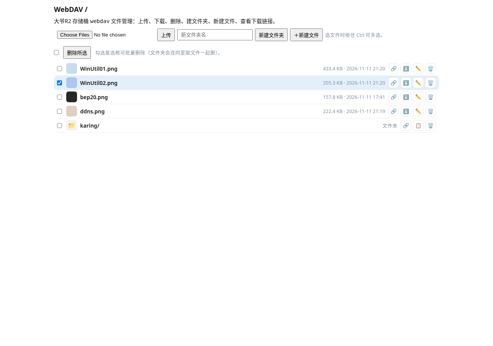
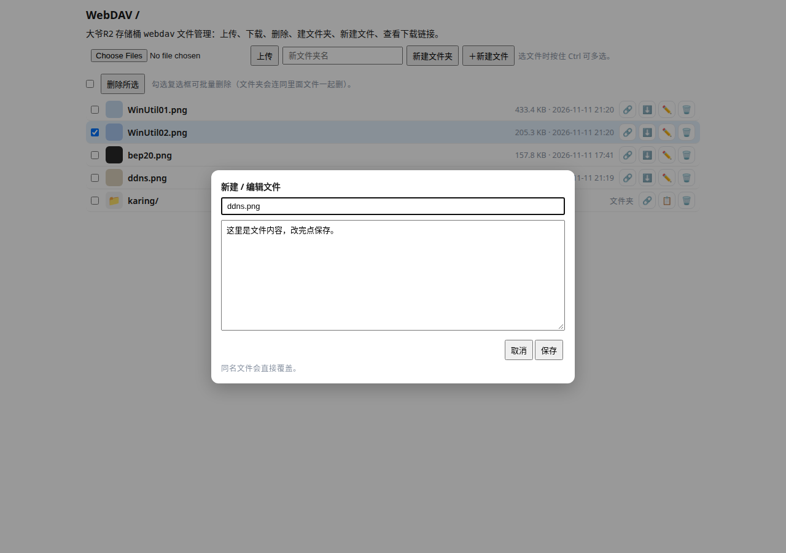
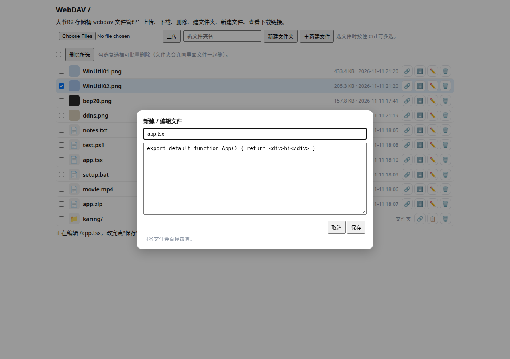

# Cloudflare Workers + R2 的 WebDAV 文件服务

用一个 Cloudflare Worker + R2 存储桶，搭一个自己的 WebDAV 网盘：手机、电脑都能用，浏览器里直接管理文件，也能挂到系统文件管理器里当网络硬盘。

- **后端**：Cloudflare Workers（`src/index.js`，单个文件，无依赖）
- **存储**：Cloudflare R2 存储桶（这里用的桶名是 `webdav`）
- **访问地址**：自定义域名（如 `https://example.com`），也可以用 Worker 自带的 `*.workers.dev` 地址

## 功能

### WebDAV 协议

标准 WebDAV 服务，支持 `OPTIONS / PROPFIND / GET / HEAD / PUT / DELETE / MKCOL / COPY / MOVE / PROPPATCH / LOCK / UNLOCK`，可直接接入各类 WebDAV 客户端：

- Windows 资源管理器（映射网络驱动器）
- macOS Finder（连接服务器）
- Cyberduck、RaiDrive、Solid Explorer、nPlayer 等
- rclone（`rclone mount` / `rclone sync`）

### 网页版文件管理

打开域名登录后就是一个文件管理器，不用装客户端：

- **紧凑列表**：复选框、文件缩略图、加粗文件名，右侧显示“大小 · 日期”，再往右是链接、下载、编辑、删除图标按钮
- **上传**：支持多选上传（选文件时按住 Ctrl 多选，一次传多个）
- **下载**：点文件名后面的 ⬇ 图标下载；点文件名本身不会下载
- **删除**：单个删除，或勾选复选框批量删除（文件夹会连同里面文件一起删），删除前会弹确认框
- **新建文件夹**：输入名字，一键创建
- **新建 / 编辑文本文件**：点工具栏“＋新建文件”，或点文件后面的 ✏️ 图标，弹出编辑框，改完点保存（同名文件直接覆盖）
- **分享链接**：点文件后面的 🔗 图标，直接复制下载链接



### 在线编辑文本文件

点文件后面的 ✏️ 图标，弹出编辑框：



只有文本格式可以编辑，例如：`txt / md / json / js / ts / tsx / jsx / css / html / xml / csv / log / yaml / ini / sh / bat / ps1 / psm1 / cmd / py / java / sql` 等。

编码方面：打开时自动识别 UTF-8 / GBK（中文 Windows 批处理 `.bat` / `.cmd` 常为 GBK），保存时按原编码写回，编辑框里也可以手动切换编码。

图片、视频、执行文件、压缩包等点 ✏️ 会弹出提示：**此文件不可编辑！**



### 权限规则

| 操作 | 是否需要登录 |
| --- | --- |
| 下载单个文件（GET / HEAD） | 不需要，可直接分享链接给别人 |
| 看文件列表、上传、删除、建文件夹、新建 / 编辑文件、PROPFIND 等 | 需要账号密码（Basic Auth） |

登录账号密码存在 Worker 的 Secrets 里（`WEBDAV_USER` / `WEBDAV_PASS`），不在代码中出现。

## 部署步骤

### 准备工作

1. 注册 / 登录 [Cloudflare](https://dash.cloudflare.com)（需要一个 Cloudflare 账号）
2. 在 R2 里建一个存储桶，例如命名为 `webdav`（R2 → Create bucket）
3. 准备一个域名（可选）：把域名托管到 Cloudflare 后，可以给 Worker 绑自定义域名，例如 `example.com`

### 方式一：Cloudflare 控制台部署（推荐，不用装工具）

1. 打开 Cloudflare 控制台 → **Workers 和 Pages** → **创建** → 选择 **Worker**，起个名字（例如 `webdav`），点部署
2. 点进这个 Worker → **设置** → **绑定** → 添加 **R2 存储桶**：变量名填 `WEBDAV_BUCKET`，存储桶选刚才建好的 `webdav`
3. **设置** → **变量和机密** → 添加两个 Secret：
   - `WEBDAV_USER`：登录用户名，例如 `admin`
   - `WEBDAV_PASS`：登录密码
4. 回到 Worker 首页，点 **编辑代码**，把 [`src/index.js`](src/index.js) 的全部内容粘贴进去，替换原有代码，点 **部署**
5. （可选）**设置** → **域和路由** → **添加自定义域**，填你的域名，例如 `example.com`

部署完成后，浏览器打开你的域名，输入账号密码登录，就能看到文件列表。

### 方式二：Wrangler 命令行部署

需要 Node.js 18+ 和一个 Cloudflare API 令牌（权限：Workers Scripts 编辑、R2 编辑、Account 读取）。

```bash
git clone https://github.com/wck166/webDAV.git
cd webDAV
npm install

# 设置登录账号密码（只存进 Worker Secrets，不写进代码）
npx wrangler secret put WEBDAV_USER
npx wrangler secret put WEBDAV_PASS

# 部署
npx wrangler deploy
```

`wrangler.toml` 里已经配好了 R2 绑定：

```toml
name = "webdav"
main = "src/index.js"
compatibility_date = "2025-01-01"

[[r2_buckets]]
binding = "WEBDAV_BUCKET"
bucket_name = "webdav"
```

> 如果 R2 存储桶换了名字，`wrangler.toml` 里的 `bucket_name` 和控制台里的绑定要一起改。

## 自测方法

部署完后，可以用 `curl` 快速验证服务是否正常（把域名换成你自己的）：

```bash
# 未登录应返回 401，要求 Basic 认证
curl -i https://example.com/

# 登录后列目录应返回 207
curl -u admin:你的密码 -X PROPFIND https://example.com/

# 上传一个测试文件，应返回 201
curl -u admin:你的密码 -T test.txt https://example.com/test.txt

# 不带密码下载这个文件，应返回 200（下载链接是公开的）
curl -i https://example.com/test.txt

# 删除测试文件，应返回 204；删完再下载应返回 404
curl -u admin:你的密码 -X DELETE https://example.com/test.txt
```

## 接入客户端举例

### Windows 资源管理器

地址栏输入 `https://你的域名`，回车后输入账号密码，即可像本地文件夹一样打开；或右键“此电脑”→“映射网络驱动器”，填入地址。

### macOS Finder

Finder → 前往 → 连接服务器（`⌘K`），输入 `https://你的域名`，输入账号密码。

### rclone

```bash
rclone config   # 新建 remote，类型选 WebDAV，url 填 https://你的域名，填账号密码
rclone ls 你的remote名:
rclone mount 你的remote名: ~/webdav
```

## 目录结构

```
webDAV/
├── src/
│   └── index.js          # Worker 全部代码（WebDAV + 网页文件管理）
├── screenshots/          # README 配图
├── wrangler.toml         # Wrangler 配置（Worker 名、R2 绑定）
├── package.json          # 依赖（wrangler）
└── README.md
```

## 注意事项

- 账号密码只放进 Worker Secrets，**不要**写进代码、不要提交到仓库。
- 下载链接是公开的：任何人拿到链接都能下载对应文件，但看不到列表、也不能上传或删除。
- Worker 自带的 `*.workers.dev` 地址可以在 Worker 设置里开关；只用自定义域名时可以把它关掉。
- R2 存储桶里已有文件不会被部署影响，删除文件请在网页上操作或用 WebDAV 客户端，不要直接在 R2 控制台误删。

## 相关链接

- [大爷博客](https://blog.118558.xyz)
